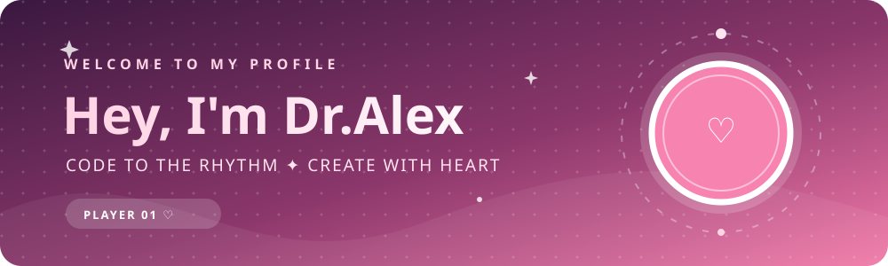
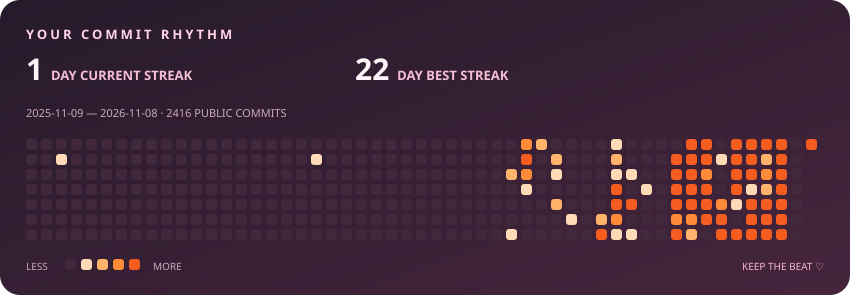

  

   
  
  

  
<i>“We code in the dark so that our family can live in the light.”</i>

 

## ♡ &nbsp; PLAYER PROFILE

Hey, I'm **Dr.Alex** ([@lighthouse2815](https://github.com/lighthouse2815)). Welcome to my GitHub profile!

Explore a few of my public projects below or visit [all repositories](https://github.com/lighthouse2815?tab=repositories).

## ✦ &nbsp; SELECT A PROJECT

| | Project | What to explore |
| :---: | :--- | :--- |
| 🎮 | [Undertale](https://github.com/lighthouse2815/undertale) | A standalone web version and a JavaScript/Phaser rewrite in progress |
| 🌙 | [Angela](https://github.com/lighthouse2815/Angela) | A Vietnamese-language AI companion |
| ⚡ | [Neon Rivals](https://github.com/lighthouse2815/Neon-Rivals) | A real-time 1v1 browser arena game |
| 🎵 | [Music for You](https://github.com/lighthouse2815/music-for-you) | A frontend-only music player |

## ♫ &nbsp; COMMIT RHYTHM

  
  
GitHub-recorded commits to public repositories · last 365 days · updated daily in UTC

  
Current streak includes yesterday if there are no commits today; best streak is limited to this 365-day window. The GitHub graph also counts other contribution types and may differ.

  
GitHub's original contribution graph keeps its own colors; this custom chart uses an orange palette.

   
  <b>Thanks for stopping by! ♡</b> 
  Keep the rhythm going ✦

